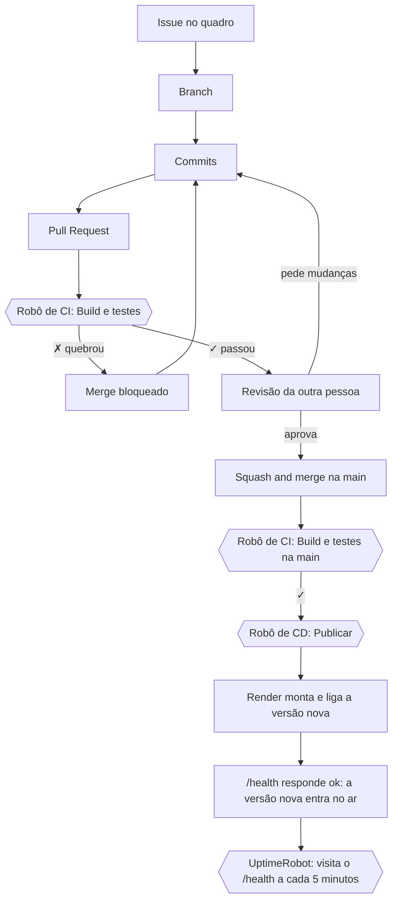

# Pipeline do Grafiaa

Como uma mudança sai do computador e chega ao site no ar, e o que cada robô confere no caminho.

## O caminho de uma mudança

## Os robôs

O arquivo dos robôs é o [.github/workflows/ci.yml](../.github/workflows/ci.yml), no GitHub Actions. Ele tem duas tarefas.

### Build e testes (CI)

Roda em todo Pull Request e em todo push na `main`, num computador emprestado do GitHub (Linux, Node 24):

| Passo | O que faz |
|---|---|
| `npm ci` | Instala as bibliotecas nas versões exatas do `package-lock.json` |
| `npm run typecheck` | Confere os tipos do TypeScript (servidor, testes e página) |
| `npm test` | Roda os testes automáticos: cada cenário de teste das issues tem o seu |
| `npm run build` | Monta a página e o servidor, como vão para o ar |

Se um passo falha, os seguintes não rodam e o PR fica com ✗ vermelho. Os testes usam um banco de mentira, em memória, então o robô não precisa de banco de dados.

### Publicar (CD)

Só roda em push na `main` (depois de um merge) e só se "Build e testes" passar. Ela chama o *deploy hook* do Render, um link secreto que diz "publica agora". O Render então baixa a `main`, roda `npm ci && npm run build`, liga o servidor com `npm start` e só troca para a versão nova quando o `/health` responde. Se a versão nova não ligar, a anterior continua no ar.

Cada publicação fica registrada em **Deployments · production**, na página do repositório.

## As regras da `main`

A `main` é protegida (Settings › Rules › Proteção da main):

- Só entra por Pull Request, com 1 aprovação.
- O check **Build e testes** é obrigatório: com ✗, o merge fica bloqueado, mesmo com o PR aprovado. A prova está no PR [#35](https://github.com/Grafiaa/Grafiaa/pull/35), que quebrou um teste de propósito e foi barrado.
- Só squash merge: cada PR vira um commit na `main`.
- Um commit novo no PR descarta a aprovação antiga.
- Ninguém apaga a `main` nem reescreve o histórico dela.

## Onde o sistema roda

| Onde | O que é | Banco de dados |
|---|---|---|
| Computador de quem programa | `npm run dev`, para construir e testar | PostgreSQL no Docker |
| CI | O computador emprestado do GitHub, que testa cada mudança | Nenhum (banco de mentira nos testes) |
| Produção | https://grafiaa.onrender.com, no Render | PostgreSQL no Neon |

As tabelas do banco são criadas e atualizadas sozinhas quando o servidor liga, pelos arquivos de `server/migracoes/`, em ordem.

## Segredos

Nenhum segredo fica no código nem no GitHub:

| Segredo | Onde fica | Para que serve |
|---|---|---|
| `DATABASE_URL` | Painel do Render | Endereço e senha do banco no Neon |
| `SESSION_SECRET` | Painel do Render | Embaralha a sessão de login |
| `RENDER_DEPLOY_HOOK_URL` | Secrets do GitHub | O link que o robô Publicar chama |

No registro do robô, o GitHub mostra o deploy hook como `***`.

## Monitoramento

- **UptimeRobot:** visita https://grafiaa.onrender.com/health a cada 5 minutos e manda e-mail se o site não responder ok. O `/health` também confere o banco, então o aviso pega servidor e banco fora do ar ([#36](https://github.com/Grafiaa/Grafiaa/issues/36)).
- **Logs do Render:** cada vez que o servidor liga, aparece "Grafiaa no ar".

## Onde ver as provas

| O quê | Onde |
|---|---|
| Cada execução dos robôs, verde ou vermelha | Aba [Actions](https://github.com/Grafiaa/Grafiaa/actions) |
| Cada publicação no ar | Deployments · production, na página do repositório |
| Um PR barrado pelo robô | PR [#35](https://github.com/Grafiaa/Grafiaa/pull/35) |
| PRs aprovados, um por issue | Aba Pull requests › Closed |
| Uma versão por sprint | Releases |
